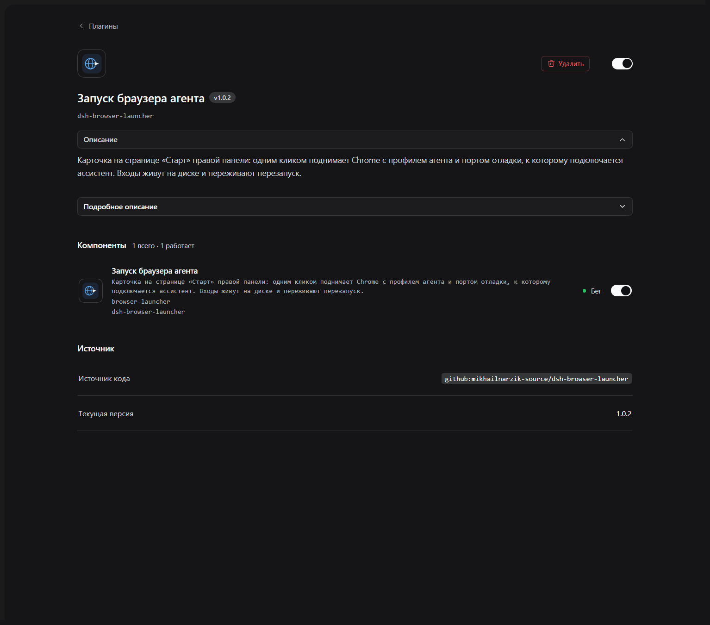

# dsh-browser-launcher — запуск браузера агента

Кнопка **«Запустить браузер»** в DeepSeek Harness: один клик открывает обычный
Chrome с отдельным профилем агента и портом отладки, к которому подключается
ассистент.



*Страница плагина в интерфейсе DSH.*

## Что это и зачем

DSH (DeepSeek Harness) — приложение, в котором вы переписываетесь с ассистентом.
Ассистент может работать со страницами в браузере: открывать сайты, читать текст,
нажимать кнопки. Делает он это не «магически», а через инструменты браузера
(сервер Playwright MCP), которые подключаются по **CDP** — протоколу отладки
Chrome — к уже запущенному окну на порту `9222`.

Если окно браузера закрыто, порт не отвечает и инструментов браузера у
ассистента нет. Обычно Chrome запускают вручную `.bat`-файлом; этот плагин
убирает ручной шаг: окно поднимается из интерфейса DSH.

Термины простыми словами:

- **профиль браузера** — отдельная папка с настройками, cookie и входами на
  сайты. Плагин использует свой профиль агента, он не мешает вашему основному
  Chrome;
- **порт отладки** — «дверь», через которую ассистент подключается к окну;
  у плагина это `9222`;
- **CDP (Chrome DevTools Protocol)** — язык, на котором инструменты браузера
  управляют окном.

Почему обычный Chrome, а не «автоматизированный»: плагин запускает Chrome
обычным процессом, без флагов автоматизации Playwright. Поэтому Google не
считает браузер «небезопасным» и вход в аккаунт не блокируется.

## Как открыть

1. Правая панель DSH → вкладка **«Старт»**. Карточка **«Запустить браузер»**
   стоит в одном ряду с «Файлами рабочей области», «Новым терминалом» и
   «Браузером».
2. Полная страница инструмента: правая панель → меню **«Дополнительные
   инструменты»** → вкладка **«Браузер агента»**. Там статус, кнопки, каталог
   профиля и порт.
3. Карточка плагина и подробная документация: левая панель → **«Плагины»** →
   карточка **«Запуск браузера агента»** → раздел **«Подробности»**.

## Как пользоваться пошагово

1. Откройте правую панель и вкладку **«Старт»**.
2. Нажмите карточку **«Запустить браузер»**. Статус на карточке сменится на
   «Запускаю…».
3. Через несколько секунд откроется окно Chrome со стартовой страницей
   `https://www.google.com/`. Статус станет **«Работает»**.
4. Если на нужном сайте требуется вход — войдите один раз вручную. Вход
   сохранится в профиле агента и переживёт перезапуск и Chrome, и DSH.
5. Попросите ассистента выполнить действие на странице, например «открой
   google.com и покажи заголовок». Инструменты браузера подключатся к открытому
   окну сами.
6. Когда браузер больше не нужен, просто закройте его окно. Ассистент потеряет
   доступ к страницам, но сохранённые входы и сессии останутся в профиле.
7. В следующий раз снова нажмите карточку — окно откроется с теми же входами.

Если порт `9222` уже занят (браузер агента уже запущен), плагин не открывает
второе окно, а сообщает, что браузер уже запущен. Кнопка **«Проверить снова»**
на странице инструмента перепроверяет статус.

## Примеры

**Как запускается браузер по шагам.**

1. Вы нажимаете карточку. Клиентская часть отправляет запрос
   `POST /api/dsh-browser-launcher/start`.
2. Host-часть плагина проверяет, слушает ли кто-то `127.0.0.1:9222`.
3. Порт занят → ответ «уже запущен», окно не открывается.
4. Порт свободен → плагин запускает программу Chrome:

   ```text
   chrome.exe --user-data-dir=%USERPROFILE%\.dsh\browser-profiles\agent
              --remote-debugging-port=9222
              --no-first-run --no-default-browser-check
              https://www.google.com/
   ```

5. Плагин ждёт до 30 секунд, пока порт `9222` начнёт принимать соединения, и
   возвращает результат: «Работает» или «Не удалось» с текстом ошибки.
6. Chrome запускается отсоединённым процессом: перезапуск DSH окно не закроет.

**Пути по умолчанию.**

| Что | Значение |
| --- | --- |
| Chrome | `C:\Program Files\Google\Chrome\Application\chrome.exe`, затем `C:\Program Files (x86)\Google\Chrome\Application\chrome.exe` |
| Профиль агента | `%USERPROFILE%\.dsh\browser-profiles\agent` |
| Порт отладки | `9222` |
| Стартовая страница | `https://www.google.com/` |

**Примеры фраз ассистенту.**

- «Открой google.com и покажи заголовок страницы» — ассистент подключится к уже
  запущенному окну.
- «Зайди на сайт и покажи, что на странице» — работает, если вы уже вошли на
  этот сайт в профиле агента.
- «Проверь, запущен ли браузер агента» — ассистент посмотрит статус порта.

**Пример с профилем, который уже открыт.** Если профиль агента открыт другим
окном Chrome без порта отладки, повторный запуск просто откроет новую вкладку в
этом окне: Chrome принимает флаг порта только при первом запуске профиля. В этом
случае закройте все окна этого профиля и нажмите карточку заново.

## Что вы увидите

**Карточка на странице «Старт».** Слева иконка-глобус с треугольником запуска,
посередине название **«Запустить браузер»** и подпись «Chrome с профилем агента и
сохранёнными входами», справа цветная точка и статус.

**Статусы карточки и страницы.**

| Статус | Значение |
| --- | --- |
| «Не запущен» | браузер агента закрыт, порт `9222` свободен |
| «Запускаю…» | Chrome стартует, идёт ожидание порта (до 30 секунд) |
| «Работает» | порт отвечает, ассистент видит окно |
| «Не удалось» | Chrome не запустился; причина написана рядом |

**Страница «Браузер агента».** Заголовок-статус («Браузер агента запущен —
ассистент видит окно» или «Браузер агента не запущен…»), кнопки **«Запустить»**
и **«Проверить снова»**, строки **«Каталог профиля»** и **«Порт отладки»**,
сообщение об ошибке (красным) и подсказка: окно — обычный Chrome, входы на диске,
закрытие окна отнимает доступ, но не сессии.

**Карточка в «Плагинах».** Название «Запуск браузера агента», описание, версия и
раздел «Подробности» с этим документом. Там же — секция плагина с кнопкой запуска,
портом и каталогом профиля.

**Единый стиль страницы.** Страница плагина — центрированная колонка до 960 px:
в шапке иконка-глобус, название «Браузер агента», подпись, чип статуса и кнопка
**«Проверить снова»**. Ниже карточки «Запуск» (кнопка **«Запустить»**, статус и
пояснение), «Профиль и порт» (каталог профиля и порт отладки) и «Как это
работает». На узком экране отступы меньше, а карточки встают в одну колонку.

**Кнопки и адаптив.** Кнопки одной системы: высота 36 px («Запустить»), 32 px
(«Проверить снова» в шапке), padding 0 14 px, радиус 10 px, ширина по тексту,
строки переносятся. «Запустить» — мягкая заливка brand 18 % с brand-рамкой и
brand-текстом: белой заливки с белым текстом нет, поэтому кнопка читается и в
тёмной теме, где brand почти белый. «Проверить снова» — secondary с рамкой.
Карточки — auto-fit сетка с минимумом 280 px, в ряду одной высоты, кнопка
«Запустить» прижата к низу карточки; длинный путь профиля переносится. На 900 и
640 px отступы уменьшаются; проверено на 1280, 1024, 768 и 480 px — ничего не
выходит за край.

## Частые ошибки и что делать

| Симптом | Причина | Что сделать |
| --- | --- | --- |
| «Не удалось: chrome.exe не найден в стандартных каталогах» | Chrome установлен в другое место или не установлен | установить Chrome в стандартное место; плагин ищет только два стандартных пути |
| «Не удалось» и окно Chrome не открылось | Chrome не смог стартовать | закрыть старые окна Chrome, повторить; проверить, что Chrome вообще запускается |
| Статус «Не удалось», хотя окно открылось | порт не поднялся за 30 секунд | закрыть все окна профиля агента и запустить заново |
| «Уже запущен», но ассистент не видит окно | порт `9222` занят другим процессом | закрыть Chrome агента; проверить, какая программа держит порт |
| Второй запуск открыл только вкладку, порт не появился | профиль уже был открыт без флага отладки | закрыть **все** окна этого профиля и запустить из карточки |
| Браузер работает, а инструментов браузера у ассистента нет | не настроен сервер Playwright MCP или он смотрит на другой порт | проверить MCP-сервер: он должен подключаться к `http://127.0.0.1:9222` |
| После перезапуска DSH окно осталось открытым | так и задумано: Chrome отсоединён | это не ошибка |
| Chrome открылся с пустым профилем | профиль агента отдельный от вашего основного | войти на сайты заново; входы сохранятся в профиле агента |

## Ограничения и безопасность

- Порт `9222` слушает только `127.0.0.1`, то есть подключиться может только
  программа на этом же компьютере. Но любая такая программа получает управление
  окном и доступ к сессии профиля — доверяйте своему компьютеру.
- Плагин не хранит и не читает пароли: cookie и входы лежат в профиле Chrome, как
  в обычном браузере. Отдельного «хранилища паролей» у плагина нет.
- Плагин не настраивается: путь к Chrome, порт и каталог профиля вычисляются по
  умолчанию. Перенести профиль в другое место через интерфейс нельзя.
- Плагин работает только с Google Chrome, установленным в стандартные каталоги.
  Microsoft Edge и другие браузеры не поддерживаются.
- Плагин не обновляет и не настраивает сам Chrome, не управляет расширениями и
  не закрывает браузер за вас.
- Chrome запускается обычным процессом, без флагов автоматизации. Поэтому
  страницы ведут себя как в обычном браузере, включая проверки Google и запросы
  разрешений.
- Для работы нужны Windows и установленный Chrome. В журнал
  `~/.dsh/dsh-browser-launcher/log.jsonl` пишутся только факты запуска
  (время и результат), без содержимого страниц и паролей.

## Связанные плагины

- **Сервер Playwright MCP** (не плагин DSH, а MCP-сервер) — даёт ассистенту
  инструменты браузера и подключается к окну по адресу
  `http://127.0.0.1:9222`. Без него плагин запустит окно, но инструментов у
  ассистента не будет.
- **dsh-android-emulator-helper** — так же помогает запускать внешнюю программу
  (эмулятор Android) из DSH, только для другого сценария.
- **dsh-polish** — единый слой оформления кнопок и полей у плагинов; карточка и
  страница браузера выглядят в общем стиле DSH.
- **dsh-cards** — карточки-итоги в ответах ассистента; удобно, когда нужно
  показать результат работы со страницей.

## Установка и обновление

Установка из репозитория:

```powershell
dsh plugin --profile desktop add github:mikhailnarzik-source/dsh-browser-launcher
```

Или в интерфейсе: **«Плагины» → «Добавить плагин»** → вставить
`github:mikhailnarzik-source/dsh-browser-launcher`. После установки
перезапустите DSH.

Обновление — через штатный менеджер плагинов: если версия на GitHub новее, у
карточки появится кнопка обновления. После обновления перезапустите DSH.
