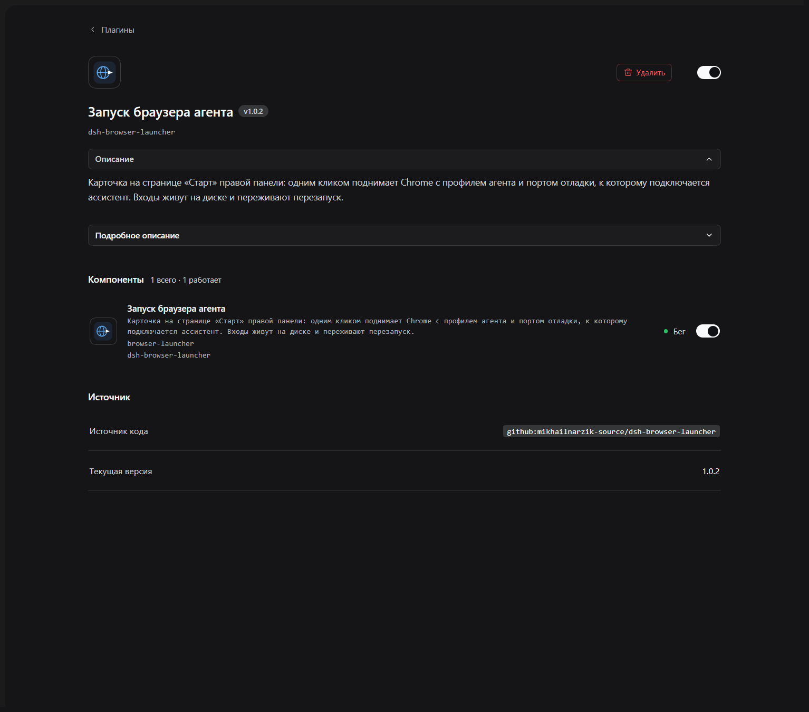

# Запуск браузера агента — подробное описание

Плагин `dsh-browser-launcher` добавляет в правую панель DSH карточку и вкладку,
которые запускают Chrome с профилем агента и портом отладки `9222`. Этот файл —
подробное руководство; краткая версия — в `README.md` плагина.

## Что это и зачем

Ассистент работает со страницами через инструменты браузера (сервер Playwright
MCP). Инструменты подключаются по CDP к **уже запущенному** Chrome на
`http://127.0.0.1:9222`. Пока окно закрыто, инструментов нет.

Раньше окно поднимали вручную `.bat`-файлом. Плагин делает то же самое из
интерфейса: карточка на странице «Старт» правой панели и отдельная вкладка
«Браузер агента».

Термины:

- **профиль** — папка с настройками, cookie и входами; у агента свой профиль,
  отдельный от основного Chrome;
- **порт отладки** — TCP-порт на `127.0.0.1`, через который внешняя программа
  управляет окном; здесь `9222`;
- **CDP** — Chrome DevTools Protocol, протокол этого управления;
- **Playwright MCP** — MCP-сервер, который даёт ассистенту браузерные
  инструменты; он подключается к CDP-эндпоинту.

Плагин не автоматизирует страницы сам: он только запускает окно и сообщает
статус. Всё управление — на стороне инструментов браузера.

## Как открыть

1. Правая панель DSH → вкладка **«Старт»** → карточка **«Запустить браузер»**
   (в ряду «Файлы рабочей области», «Новый терминал», «Браузер»).
2. Правая панель → меню **«Дополнительные инструменты»** → вкладка
   **«Браузер агента»** — полная страница со статусом.
3. Левая панель → **«Плагины»** → карточка **«Запуск браузера агента»** →
   раздел **«Подробности»** (этот документ).
4. Левая панель → строка **«Браузер агента»** с эмодзи 🌐 открывает те же
   настройки запуска без страницы плагин-менеджера. Строка видна, пока панель
   закреплена (по умолчанию так); откреплённая остаётся в меню **«Ещё»**.
   Закреплением управляет плагин «Оформление интерфейса» (`dsh-polish`).

Отдельного включателя у плагина нет: если он установлен, карточка и вкладка
доступны. Плагин не требует настроек — путь к Chrome, каталог профиля и порт
вычисляются по умолчанию.

## Как пользоваться пошагово

1. Откройте правую панель, вкладку «Старт».
2. Нажмите карточку. Статус: «Не запущен» → «Запускаю…» → «Работает» (или
   «Не удалось» с причиной).
3. Дождитесь окна Chrome. Откроется стартовая страница `https://www.google.com/`.
4. При необходимости войдите на сайты вручную — вход сохранится в профиле.
5. Работайте с ассистентом: его браузерные инструменты подключатся к открытому
   окну по CDP.
6. Проверить статус вручную: страница «Браузер агента» → **«Проверить снова»**.
7. Закрыть окно — достаточно закрыть Chrome. Сохранённые входы останутся.
8. Запустить снова — та же карточка.

**Что происходит при повторном запуске.** Плагин сначала проверяет порт. Если
порт занят, возвращается ответ «уже запущен» и второе окно не открывается. Если
профиль агента открыт без порта отладки, Chrome откроет новую вкладку в старом
окне и порт не поднимется — нужно закрыть все окна этого профиля и запустить
заново.

## Примеры

**Маршруты Host-части.**

| Маршрут | Метод | Что делает |
| --- | --- | --- |
| `/api/dsh-browser-launcher/status` | POST | проверяет, слушает ли `127.0.0.1:9222`, и возвращает `running`, `port`, `profileDir`, `chromePath` |
| `/api/dsh-browser-launcher/start` | POST | если порт занят — `{ running: true, already: true }`; иначе запускает Chrome и ждёт порт до 30 секунд |

**Аргументы запуска Chrome.**

```text
chrome.exe
  --user-data-dir=%USERPROFILE%\.dsh\browser-profiles\agent
  --remote-debugging-port=9222
  --no-first-run
  --no-default-browser-check
  https://www.google.com/
```

Процесс создаётся отсоединённым (`detached`, `unref`), поэтому перезапуск DSH
окно не закрывает. Плагин не использует Playwright для запуска — именно поэтому
Google не помечает браузер как автоматизированный и не блокирует вход.

**Пути и параметры.**

| Параметр | Значение |
| --- | --- |
| Chrome (первый найденный) | `C:\Program Files\Google\Chrome\Application\chrome.exe` |
| Chrome (запасной) | `C:\Program Files (x86)\Google\Chrome\Application\chrome.exe` |
| Профиль | `%USERPROFILE%\.dsh\browser-profiles\agent` |
| Порт отладки | `9222` |
| Стартовая страница | `https://www.google.com/` |
| Ожидание порта | до 30 секунд, проверка каждые 400 мс |
| Журнал | `~/.dsh/dsh-browser-launcher/log.jsonl` |

**Настройка Playwright MCP.** Сервер должен быть запущен с CDP-эндпоинтом
`http://127.0.0.1:9222` (флаг `--cdp-endpoint`). Тогда инструменты браузера
подключаются к этому окну сбоку и не перезапускают его. Плагин и MCP-сервер —
разные вещи: плагин открывает окно, MCP даёт инструменты.

**Пример сценария.** «Открой сайт, найди строку поиска, введи запрос и покажи
результаты» — при запущенном окне и настроенном Playwright MCP ассистент
выполнит шаги инструментами браузера.

## Что вы увидите

**Карточка на «Старте».** Иконка-глобус с треугольником, название «Запустить
браузер», подпись «Chrome с профилем агента и сохранёнными входами», справа
цветная точка и статус. Клик по всей площади карточки запускает браузер, пока
он не запускается.

**Статусы.**

| Статус | Цвет точки | Значение |
| --- | --- | --- |
| «Не запущен» | серая | порт `9222` свободен |
| «Запускаю…» | жёлтая | Chrome стартует, ждём порт |
| «Работает» | зелёная | порт отвечает |
| «Не удалось» | красная | ошибка; текст причины рядом с подписью |

**Страница «Браузер агента».** Заголовок-статус, две кнопки («Запустить» и
«Проверить снова»), строки «Каталог профиля: …» и «Порт отладки: 9222», красное
сообщение об ошибке, если она есть, и подсказка про обычный Chrome, профиль и
сохранённые входы.

**Карточка в «Плагинах».** Название «Запуск браузера агента», описание, версия,
раздел «Подробности» с этим документом и секция плагина.

**Своя панель в левой панели.** Строка «Браузер агента» с эмодзи 🌐 открывает
центрированную страницу до 960 px с той же шапкой (🌐, название, подпись) и теми
же карточками «Запуск», «Профиль и порт» и «Как это работает». Блоков
плагин-менеджера («Описание», «Источник», «Версия») там нет: клик в левой панели
показывает только настройки запуска. Откреплённая строка уходит в меню «Ещё», а
страница настроек остаётся доступной через «Плагины».

## Как это выглядит



*Рисунок 1. Страница плагина: описание, настройки и кнопки.*


*Рисунок 2. Рабочий раздел плагина: органы управления и результат.*

Страница плагина оформлена в едином стиле: центрированная колонка шириной до
960 px, в шапке иконка-глобус, название «Браузер агента», подпись, чип статуса
(«Не запущен», «Запускаю…», «Работает», «Не удалось») и кнопка **«Проверить
снова»**. Ниже — карточки «Запуск» с кнопкой **«Запустить»**, «Профиль и порт»
с каталогом профиля и портом отладки и карточка «Как это работает». На широком
экране карточки стоят в двух колонках, на узком (до 760 px) — в одной, и отступы
уменьшаются. Та же страница открывается в «Плагинах» как секция плагина.

**Кнопки и адаптив.** Кнопки одной системы: высота 36 px («Запустить»), 32 px
(«Проверить снова» в шапке), padding 0 14 px, радиус 10 px, ширина по тексту,
`white-space:nowrap`. «Запустить» — мягкая заливка brand 18 %, рамка brand 55 %
и brand-текст (не белая заливка с белым текстом: в тёмной теме brand сам белый);
«Проверить снова» — secondary с рамкой layer-l4. Сетка карточек —
`repeat(auto-fit, minmax(min(100%, 280px), 1fr))`, карточки в ряду одной высоты,
кнопка «Запустить» прижата к низу карточки (`margin-top:auto`). Каталог профиля
переносится по символам, поэтому длинный путь не растягивает страницу.
Медиазапросы 900 и 640 px: одна колонка, отступы 18/16/32; проверено на 1280,
1024, 768 и 480 px — горизонтальной прокрутки страницы нет.

## Частые ошибки и что делать

| Симптом | Причина | Что сделать |
| --- | --- | --- |
| «chrome.exe не найден в стандартных каталогах» | Chrome не установлен или стоит в нестандартном месте | установить Chrome в стандартный каталог; других путей плагин не знает |
| «Не удалось» сразу после клика | Chrome не смог запуститься (занят профиль, нет прав, повреждена установка) | закрыть все окна Chrome, повторить; проверить запуск Chrome вручную |
| «Не удалось», но окно Chrome открылось | порт не поднялся за 30 секунд | закрыть все окна профиля агента и запустить заново; возможно, мешает политика Chrome |
| «Уже запущен», но ассистент не видит страниц | порт `9222` занят другим процессом, не тем окном | закрыть все окна Chrome агента; найти программу, держащую порт |
| Второй клик открыл только вкладку | профиль уже был открыт без порта отладки | закрыть **все** окна этого профиля, затем запустить из карточки |
| Инструменты браузера недоступны | Playwright MCP не запущен или смотрит на другой порт | настроить MCP на `--cdp-endpoint http://127.0.0.1:9222`, перезапустить сервер |
| Вход на сайт не сохранился | вход выполнялся в другом профиле или в режиме инкогнито | входить в окне, открытом плагином; профиль агента — отдельный |
| Окно закрывается при выходе из DSH | этого быть не должно: Chrome отсоединён | проверить, что окно открыто именно плагином, а не вкладкой-браузером DSH |
| После перезапуска DSH карточка пишет «Не запущен», хотя окно есть | порт закрылся или Chrome работает с другим профилем | нажать «Проверить снова»; при необходимости перезапустить окно из карточки |

## Ограничения и безопасность

- **Только Windows и только Google Chrome** из двух стандартных каталогов. Edge,
  Firefox и портативные сборки не поддерживаются; настроек пути нет.
- **Порт `9222` слушает только `127.0.0.1`.** Снаружи компьютера к нему не
  подключиться. Но любая программа на этой машине, подключившаяся к порту,
  получает управление окном и доступ к сессии профиля — это доверие к локальной
  системе.
- Плагин не хранит и не вводит пароли: входы лежат в профиле Chrome на диске, как
  в обычном браузере. Файлы профиля плагин не читает.
- Плагин не управляет Chrome: не обновляет, не устанавливает расширения, не
  закрывает окно, не меняет настройки.
- Плагин не даёт ассистенту «власть над компьютером»: он лишь запускает окно.
  Доступ к страницам появляется через инструменты Playwright MCP — их
  безопасность настраивается отдельно.
- Chrome запускается без флагов автоматизации, поэтому сайты видят обычный
  браузер. Это плюс для входов, но минус для скрытности: проверки и капчи
  работают как обычно.
- В журнал `~/.dsh/dsh-browser-launcher/log.jsonl` пишутся только время, факт и
  результат запуска; содержимое страниц и учётные данные не записываются.
- Плагин личный, без гарантий.

## Связанные плагины

- **Сервер Playwright MCP** — не плагин DSH, а MCP-сервер браузерных
  инструментов; подключается к `http://127.0.0.1:9222`. Без него окно
  открывается, но ассистент не получает инструментов.
- **dsh-android-emulator-helper** — похожий помощник: запускает внешнюю программу
  (Android-эмулятор) из DSH и управляет ею.
- **dsh-polish** — общий слой оформления; карточка и страница наследуют стиль
  DSH.
- **dsh-cards** — карточки-итоги в ответах; удобно показывать результат работы со
  страницей.
